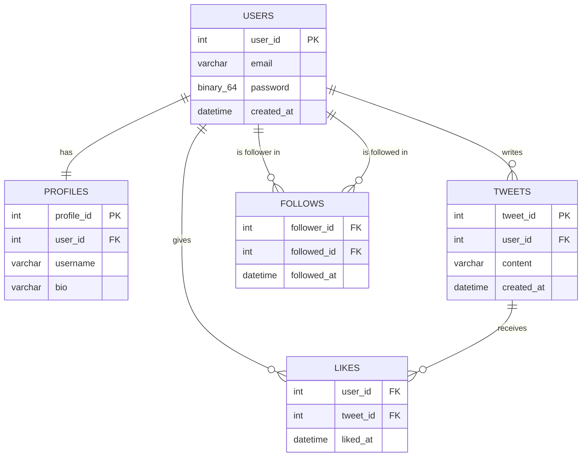

# محاكاة قاعدة بيانات تويتر (Twitter Clone - SQL Project)

مشروع قاعدة بيانات يحاكي الوظائف الأساسية لموقع تويتر: المستخدمين، الملفات الشخصية،
المتابعة بين المستخدمين، التغريدات، والإعجاب بالتغريدات.

## الكيانات (Entities) والعلاقات

- **USERS**: بيانات الحساب الأساسية (البريد الإلكتروني، الرقم السري المشفّر، تاريخ الإنشاء).
- **PROFILES**: الملف الشخصي المرتبط بكل مستخدم (اسم المستخدم، نبذة) — علاقة **واحد لواحد** مع USERS.
- **TWEETS**: التغريدات، كل تغريدة تتبع لمستخدم واحد — علاقة **واحد لمتعدد** من USERS إلى TWEETS.
- **FOLLOWS**: جدول ربط يمثل علاقة **متعدد لمتعدد** بين المستخدمين أنفسهم (متابِع / متابَع).
- **LIKES**: جدول ربط يمثل علاقة **متعدد لمتعدد** بين USERS و TWEETS (من أعجب بأي تغريدة).

## ER Diagram

## ملاحظات التنفيذ

- الرقم السري (password) مخزّن كنوع `BINARY(64)` ويتم تشفيره باستخدام دالة `MD5()` قبل التخزين.
- كل عمود رقم تسلسلي (`user_id`, `profile_id`, `tweet_id`) يُعبّأ تلقائيًا باستخدام `AUTO_INCREMENT`.
- تاريخ إنشاء الحساب والتغريدة والمتابعة والإعجاب يُعبّأ تلقائيًا بالوقت الحالي باستخدام `DEFAULT CURRENT_TIMESTAMP`.
- تم إنشاء Procedure باسم `createAccount` لإضافة المستخدم وملفه الشخصي دفعة واحدة.
- تم إنشاء Procedure باسم `User_Follow` لإضافة علاقة متابعة بين مستخدمين بالاعتماد على اسم المستخدم فقط.

جميع تفاصيل الأكواد موجودة في ملف `twitter_db.sql`.
